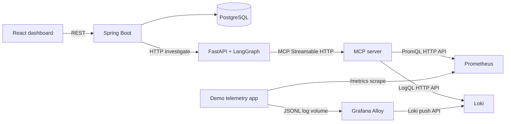

# NEXUS AI architecture

## Services

- **React dashboard** submits alerts to Spring Boot and displays the stored report, including the selected telemetry mode, Prometheus/Loki evidence, MCP trace and four-agent LangGraph trace.
- **Spring Boot API** validates and persists incidents in PostgreSQL, calls FastAPI synchronously, and stores the complete JSON report.
- **FastAPI agent service** validates the alert and invokes the existing LangGraph `StateGraph` over the centralized `IncidentState`.
- **MCP server** publishes four read-only observability tools over Streamable HTTP. It uses allowlisted PromQL/LogQL and talks to Prometheus and Loki.
- **Prometheus** scrapes the demo telemetry app at a five-second interval. **Grafana Alloy** tails its JSONL log volume and pushes structured logs to **Loki**.
- **Demo telemetry app** is a local FastAPI workload generator. It exports Prometheus metrics and structured logs for five bounded scenarios.
- **PostgreSQL**, Prometheus, Loki and Alloy use named volumes for local persistence.

## Request and state flow

1. The dashboard sends `POST /api/v1/incidents` to Spring Boot.
2. Spring stores the incident, calls FastAPI `/investigate`, then stores the full response in PostgreSQL JSONB and returns it to the dashboard.
3. The graph runs Alert Analysis → Investigation → Root Cause Analysis → Remediation Recommendation → report. Each agent receives and returns updates to the same `IncidentState`.
4. The Investigation Agent opens an MCP client session, discovers tools with `tools/list`, validates the required tool names, and calls three scenario-selected Prometheus metrics plus application logs, service health and resource usage.
5. The MCP server queries configured Prometheus/Loki endpoints. Real mode is the default. Fixture mode is used only when `TELEMETRY_MODE=mock` is explicitly set.
6. The agent service returns metric/log evidence, tool schemas and call trace. RCA validates citations against returned records, then Spring persists the complete report.
7. Any graph-node failure is recorded and conditional routing stops the remaining workflow. Real telemetry connection errors and no-data results are visible failures; they do not switch to fixture data.

## Telemetry and model modes

`TELEMETRY_MODE` and `LLM_PROVIDER` control different things. By default telemetry is `real` (actual calls to the local Prometheus and Loki services) while the LLM is `mock` (deterministic agent outputs). The dashboard labels both independently. Real telemetry still comes from the synthetic local workload generator, not a production service.

`TELEMETRY_MODE=mock` explicitly returns scenario fixtures through the MCP tools. It is useful for repeatable tests when no telemetry stack is running. Invalid modes are rejected by settings validation.

## Safety boundaries and known limitations

- MCP exposes a fixed set of read-only metrics, log, health and resource tools. PromQL metric names, log search terms, service labels, time ranges and limits are validated.
- The demo's thread and memory scenarios perform bounded local work. Pool contention, database latency and dependency failure are controlled simulations. No external DB or dependency is called.
- Recommendations are never executed. There is no cloud, Kubernetes, Terraform, ITSM or production write integration.
- RCA checks evidence IDs and scenario-specific lexical indicators. These checks catch unsupported IDs and missing terms but are not a semantic proof of causation.
- Spring and FastAPI investigations are synchronous with bounded timeouts. A production deployment would need authentication, authorization, deployment secrets, queueing/backpressure, and operational retention policies.
